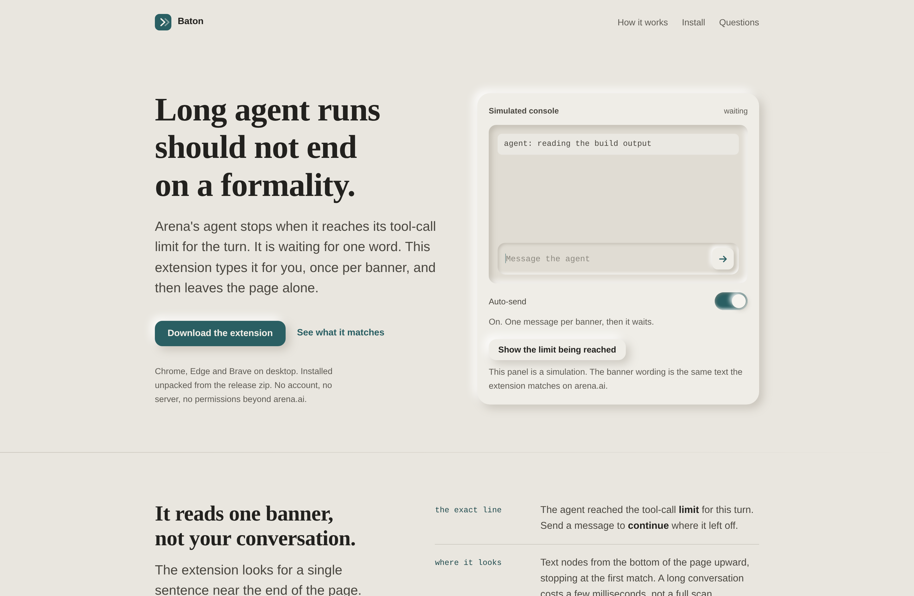
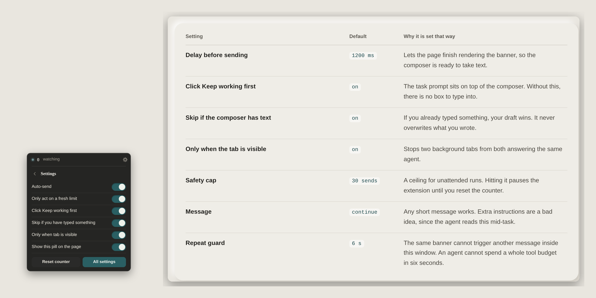

# Baton

Baton is a small Chrome extension for [arena.ai/agent](https://arena.ai/agent). When the agent reaches
its tool-call limit for the turn, it types `continue` into the message box and sends it, once per
banner, then waits for the next one.



Arena's agent stops mid-task when it runs out of tool calls, and waits for a message before it
resumes. If you start a long build and walk away, the run sits there until you come back. This
extension watches for that one banner and answers it.

It is deliberately narrow. It reacts to the sentence about the tool-call limit, sends one message,
and then waits for the next limit. It does not poll for "idle" states, guess when the agent is
thinking, or read your conversations.

## What it looks like

On the left, the pill with its settings open, which is how you reach them on any arena.ai page. On the
right, the defaults it ships with and why each one is set that way:



## Install

The extension is not published to the Chrome Web Store, so you load it unpacked from a release. The
landing page offers two routes to the same zip: download it directly, or open the release on GitHub.

1. Download `baton.zip` from the [latest release](https://github.com/sarang-cmd/baton/releases/latest) and unzip it.
2. Open `chrome://extensions` (`edge://extensions` in Edge, `brave://extensions` in Brave).
3. Turn on **Developer mode** in the top right.
4. Choose **Load unpacked** and select the unzipped folder, the one containing `manifest.json`.
5. Open [arena.ai/agent](https://arena.ai/agent) and start a task. A small pill in the bottom corner
   shows that it is watching. Hover it to see the last action, and click the gear to open settings.

Works in Chrome and other Chromium browsers on desktop. Firefox is not supported yet, since it needs
a manifest variant and a different extension namespace.

## Settings

Settings live in the pill itself. Hover the pill to expand it, then click the gear in its top right
corner. The gear swaps the plate to a settings page in place, without opening a window over the page.
**All settings** opens the same panel as a full page, which is also where the toolbar icon goes. Both
places read and write the same stored values.

The pill carries the switches, because those are the ones you change while a run is going. The full
page adds the numbers, the target override, and a search box that filters the list by name or by what
the setting does. A change made in one place appears in the other straight away, without reloading.

| Setting | Default | What it does |
| --- | --- | --- |
| Auto-send | on | The master switch. |
| Click Keep working first | on | The "Was this task successful?" panel covers the message box, so it is dismissed before typing. |
| Only act on a fresh limit | on | Ignores banners left over from earlier turns. |
| Keep working button | built-in | Can be replaced with a selector or a position, see below. |
| Only when tab is visible | on | Skips background tabs so two tabs cannot both answer the agent. |
| Skip if you have typed something | on | Your draft always wins. It never overwrites text already in the composer. |
| Status pill on the page | on | The small indicator in the bottom right corner of the page. |
| Response complete | on | Notify when the agent finishes a response. |
| Agent asks a question | on | Notify when the agent stops and waits for an answer from you. |
| Tool-call limit | on | Notify when the run hits the limit, and say whether Baton answered it. |
| Include text in notification | off | Adds a snippet to the body. Off means the body never contains model output. |
| Notify when it pauses | on | Baton's own status message at the safety cap or after a send that changed nothing. |
| Message | `continue` | The text it sends. |
| Delay | `1200` ms | Wait after the banner appears, so the composer is ready. |
| Safety cap | `30` | Pauses after this many consecutive sends until you reset the counter. |

The pill also shows a session counter, and **Reset counter** clears both the counter and a paused
state.

## Notifications

Three events, one notification each, whether or not Baton is sending:

| Event | Title | Fires when |
| --- | --- | --- |
| Response complete | `Arena: response complete` | The last assistant message stops being pending and carries a `done` part |
| Agent asks a question | `Arena: agent is asking you a question` | A `tool-ask_user` part goes from `input-available` to `output-available` |
| Tool-call limit | `Arena: tool-call limit reached` | The limit banner appears, with a line saying whether auto-continue answered it |

Each event fires once per turn, per thread, per model. The dedupe key is
`threadId|turnId|type|model` and the keys live in `chrome.storage.session`, so they survive a reload
of the tab but not a restart of the browser, and they are shared across tabs. The list is capped at
400 keys, oldest pruned first.

The body names the thread and the mode. It never contains the question, the answer, your prompt, a
cookie or an account id, unless you switch **Include text in notification** on. Clicking a
notification focuses the tab that holds that thread, and switches to it if it is in another window.

The three toggles are independent. **Send a test notification** on the options page checks that the
operating system is letting them through.

Supported modes are Agent, Coding, Direct and Side by side. A side-by-side turn produces one
notification per model, because the two models finish at different times. Battle and modal turns are
silent: there is no verified signal for them, so Baton does not guess.

## How the detection works

The content script looks for this text:

> The agent reached the tool-call limit for this turn. Send a message to continue where it left off.

A few details that matter in practice:

- **A banner only counts if it is the newest thing in the conversation.** A limit notice stays in the
  transcript after the turn it belonged to, and answering it again sends a message nobody asked for.
  The extension checks that nothing meaningful follows the notice, ignoring the composer bar and
  other page furniture, and that the agent is not still working.
- **Nothing new means nothing sent.** The text at the end of the conversation is fingerprinted after
  each send, with the banner wording stripped out. If that fingerprint has not changed, a banner on
  screen is history and is left alone.
- **It confirms the send did something.** After clicking, it watches for the banner to clear or for
  the conversation to change, and if neither happens within six seconds it holds off for twenty.
- **It scans text nodes from the bottom of the page upward** and stops at the first match, so a long
  conversation costs a few milliseconds instead of a full document scan.
- **The "send a message to continue" sentence alone does not trigger it.** The words about the
  tool-call limit have to be present nearby, so a conversation that merely mentions the phrase cannot
  set it off.
- **One send per occurrence.** After a send the extension disarms until the banner has been gone for
  a clear window, and identical banner text is ignored for 6 seconds. Re-renders that flicker the
  banner do not produce a second message.
- **The task prompt is cleared first.** After the banner, Arena shows a "Was this task successful?"
  panel with Yes, No and Keep working, and it sits on top of the message box. The extension clicks
  Keep working, waits for the prompt to close, and only then types. The button is chosen by proximity
  to that panel, so a "Keep working" control elsewhere on the page is left alone.
- **Sending uses real events.** It sets the value through the native setter (or `execCommand` in a
  contenteditable), dispatches input events, then clicks the send button or presses Enter.

It runs only on `arena.ai`. There is no network code, no analytics, and no remote configuration.

## When the button moves

Arena's "Keep working" control is found by its markup first, then by its label, then by the target you
picked yourself. If a redesign breaks all of that, open settings and press **Pick on page**: click the
button once on the page, and the extension stores its CSS selector plus its position as a share of the
window. Because the position is a fraction rather than a pixel coordinate, it still lands on the same
spot after a resize or on a different monitor.

You can also type a selector, or an X and Y percentage, into the same panel. **Use built-in** removes
the override.

## Update notices

The settings page checks the releases feed at most once every six hours and shows a banner when a
newer version exists, with a direct link to the zip and to the release notes. Nothing is installed without
you: an extension loaded unpacked cannot update itself, so download the new zip and load it over the
old folder.

## Development

The extension has no build step for the browser, and no runtime dependencies. `content.js`,
`background.js`, `notifications/*.js`, `ui/panel.js` and the manifest are loaded directly by the
browser; `scripts/build.sh` only copies them into `dist/` and zips the result.

```bash
git clone https://github.com/sarang-cmd/baton
cd baton

# run both suites: the notification layer, then the page behaviour
npm install
npm test

# produce a zip you can load unpacked
bash scripts/build.sh
```

The tests simulate an arena.ai page in jsdom and check the behaviour that is easy to get wrong:
one send per banner, no send without the banner, no overwriting a draft, no repeat sends when the
banner never clears, re-arming for a later limit, flicker tolerance, the contenteditable path, the
gear opening settings inside the pill, a switch in the pill reaching storage, two surfaces staying in
step, and search filtering the list. The notification suite runs on Node's own test runner against
recorded `/api/chat` and `/api/evaluation` responses under `test/fixtures/`, which
`python3 scripts/make-fixtures.py` regenerates from the sanitised captures. Those fixtures carry no
prompt, answer, key, cookie or account id, and `make-fixtures.py` fails the build if one appears.

```
PASS  detects notice and sends exactly once  - sends=1
PASS  sends the word "continue"  - "continue"
PASS  silent when no notice is present  - sends=0
PASS  skips when composer already has text  - sends=0
PASS  no repeat fires for a notice that never clears  - sends=1 in 9s
PASS  fires again on a later, separate limit notice  - sends=2 (first=1)
PASS  clicks Keep working when the task prompt is showing  - keepClicks=1
PASS  ignores a Keep working button outside the prompt  - stray=0 sends=1
PASS  ignores a limit banner that is not the latest message  - sends=0
PASS  uses the saved override selector when one exists  - overrideClicks=1
PASS  gear opens the settings view inside the pill  - closedFirst=true open=true
PASS  pill settings are switches only, no popup window  - toggles=6 dialogs=0
PASS  a switch in the pill saves to storage  - useKeepWorking=false
PASS  does nothing when auto-send is off  - sends=0
PASS  one limit banner emits exactly one tool_limit_reached event  - events=1
PASS  the limit event and the send agree on the turn  - turnId=msg-00
PASS  the first claim of an event is accepted  - first=true
PASS  the second claim of the same event is refused  - second=false
PASS  a third claim is still refused, as after a reload  - third=false
PASS  two models and two turns are three separate notifications  - keys=3

39/39 passed

$ node --test test/notifications.test.js
...
22/22 passed
```

The screenshots in this README are regenerated with `node scripts/shots.js`, which needs
`playwright-core` and a Chromium download.

### Files

```
manifest.json        Manifest V3, matches arena.ai, notifications + webRequest
content.js           detection, composer insertion, guards, on-page pill
notifications/events.js    the event rules, pure functions, no DOM or chrome
notifications/observe.js   polls /api/chat, turns responses into events
notifications/dedupe.js    once-per-turn keys, in chrome.storage.session
notifications/notifier.js  wording and title truncation
notifications/worker.js    intake, dedupe, click to focus, webRequest intake
background.js        toolbar button opens settings, relays messages to the tab
settings.html/js     the settings page
ui/settings.js       the one settings store, read by every surface
ui/panel.js          the settings UI, mounted in the pill and on that page
icons/               toolbar icons, generated by scripts/make-icons.py
site/icon-*.png      the same mark at 32, 180, 192 and 512 px for the web
site/                landing page, privacy and terms pages (static, no build)
test/test.js         page behaviour, jsdom
test/notifications.test.js  the event rules, Node's test runner
test/fixtures/       recorded Arena responses, regenerated by scripts/make-fixtures.py
scripts/build.sh     packs the extension into dist/
scripts/shots.js     regenerates docs/images
scripts/make-icons.py      draws the icon at every size, plus the SVG
scripts/compose-figure.py  builds the combined pill + settings figure
docs/images/         screenshots used above
```

## Landing page

`site/` is a static page you can open directly in a browser, or serve with any static host. It has
an interactive simulation of the console that uses the same banner wording the extension matches.

## Privacy and terms

- [Privacy](site/privacy.html): what is stored locally and what never leaves your machine.
- [Terms](site/terms.html): currently a draft that needs legal review before it is treated as final.

## Known limits

- It is tested against a simulated page, not against a live Arena session. If Arena renames or
  restructures the banner, the extension stops sending rather than sending something wrong.
- It does not work in Firefox or on mobile browsers.
- **A response you stopped by hand may still notify as complete.** Arena shows a stopped turn in a way
  that none of the recorded responses captured, so Baton suppresses the notification only when it sees
  positive evidence of a stop. Otherwise it errs towards telling you, which is wrong in that one case.
  This is marked unverified in `TEST_MATRIX.md`.
- Notifications for Direct, Battle and Side by side are newer and thinner than the agent ones. Battle
  and modal turns are deliberately silent.
- Notifications need the `notifications` permission, and reading the evaluation message ids needs
  `webRequest`. Both are declared at install; `CHANGES.md` says why.
- If your agent has a per-turn limit counted server-side, sending `continue` costs you a new turn and
  counts against that. Reading Arena's own usage terms is on you.

## Licence

MIT. See [LICENSE](LICENSE).

Not affiliated with Arena. Independent tool, use at your own risk.
