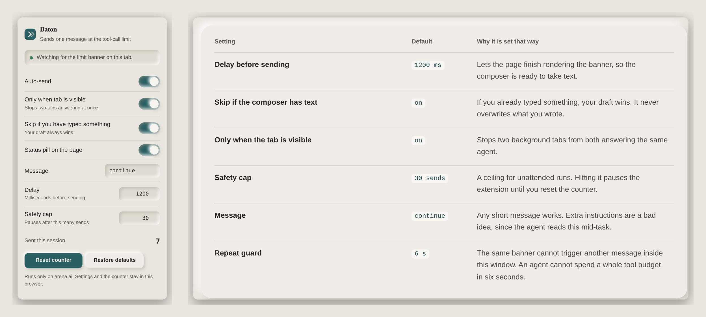

# Baton

Baton is a small Chrome extension for [arena.ai/agent](https://arena.ai/agent). When the agent reaches
its tool-call limit for the turn, it types `continue` into the message box and sends it, once per
banner, then waits for the next one.


Arena's agent stops mid-task when it runs out of tool calls, and waits for a message before it
resumes. If you start a long build and walk away, the run sits there until you come back. This
extension watches for that one banner and answers it.

It is deliberately narrow. It reacts to the sentence about the tool-call limit, sends one message,
and then waits for the next limit. It does not poll for "idle" states, guess when the agent is
thinking, or read your conversations.

## What it looks like

On the left, the popup on an arena.ai tab. On the right, the defaults it ships with and why each one
is set that way:



## Install

The extension is not published to the Chrome Web Store, so you load it unpacked from a release.

1. Download `baton.zip` from the [latest release](https://github.com/sarang-cmd/baton/releases/latest) and unzip it.
2. Open `chrome://extensions` (`edge://extensions` in Edge, `brave://extensions` in Brave).
3. Turn on **Developer mode** in the top right.
4. Choose **Load unpacked** and select the unzipped folder, the one containing `manifest.json`.
5. Open [arena.ai/agent](https://arena.ai/agent) and start a task. A small pill in the bottom corner
   shows that it is watching.

Works in Chrome and other Chromium browsers on desktop. Firefox is not supported yet, since it needs
a manifest variant and a different extension namespace.

## Settings

Open the toolbar icon on any arena.ai page.

| Setting | Default | What it does |
| --- | --- | --- |
| Auto-send | on | The master switch. |
| Only when tab is visible | on | Skips background tabs so two tabs cannot both answer the agent. |
| Skip if you have typed something | on | Your draft always wins. It never overwrites text already in the composer. |
| Status pill on the page | on | The small indicator in the bottom right corner of the page. |
| Message | `continue` | The text it sends. |
| Delay | `1200` ms | Wait after the banner appears, so the composer is ready. |
| Safety cap | `30` | Pauses after this many consecutive sends until you reset the counter. |

The popup also shows a session counter, and **Reset counter** clears both the counter and a paused
state.

## How the detection works

The content script looks for this text:

> The agent reached the tool-call limit for this turn. Send a message to continue where it left off.

A few details that matter in practice:

- **It scans text nodes from the bottom of the page upward** and stops at the first match, so a long
  conversation costs a few milliseconds instead of a full document scan.
- **The "send a message to continue" sentence alone does not trigger it.** The words about the
  tool-call limit have to be present nearby, so a conversation that merely mentions the phrase cannot
  set it off.
- **One send per occurrence.** After a send the extension disarms until the banner has been gone for
  a clear window, and identical banner text is ignored for 6 seconds. Re-renders that flicker the
  banner do not produce a second message.
- **Sending uses real events.** It sets the value through the native setter (or `execCommand` in a
  contenteditable), dispatches input events, then clicks the send button or presses Enter.

It runs only on `arena.ai`. There is no network code, no analytics, and no remote configuration.

## Development

The extension has no build step and no dependencies. `content.js`, `popup.js` and the manifest are
loaded directly by the browser.

```bash
git clone https://github.com/sarang-cmd/baton
cd baton

# run the jsdom test suite
npm install
npm test

# produce a zip you can load unpacked
bash scripts/build.sh
```

The tests simulate an arena.ai page in jsdom and check the behaviour that is easy to get wrong:
one send per banner, no send without the banner, no overwriting a draft, no repeat sends when the
banner never clears, re-arming for a later limit, flicker tolerance, and the contenteditable path
that has no send button.

```
PASS  detects notice and sends exactly once  — sends=1
PASS  sends the word "continue"  — "continue"
PASS  silent when no notice is present  — sends=0
PASS  skips when composer already has text  — sends=0
PASS  no repeat fires for a notice that never clears  — sends=1 in 9s
PASS  fires again on a later, separate limit notice  — sends=2 (first=1)
PASS  ignores the continue line without the tool-call limit line  — sends=0
PASS  works with a contenteditable composer (Enter path)  — [{"via":"enter","text":"continue"}]
PASS  contenteditable cleaned up after send  — ""
PASS  re-render flapping does not cause a second send  — sends=1 (first=1)

10/10 passed
```

The screenshots in this README are regenerated with `node scripts/shots.js`, which needs
`playwright-core` and a Chromium download.

### Files

```
manifest.json        Manifest V3, matches arena.ai, storage + activeTab
content.js           detection, composer insertion, guards, on-page status pill
popup.html/js        settings UI and session counter
icons/               toolbar icons
site/                landing page, privacy and terms pages (static, no build)
test/test.js         jsdom test suite
scripts/build.sh     packs the extension into dist/
scripts/shots.js     regenerates docs/images
scripts/compose-figure.py  builds the combined popup + settings figure
docs/images/         screenshots used above
```

## Landing page

`site/` is a static page you can open directly in a browser, or serve with any static host. It has
an interactive simulation of the console that uses the same banner wording the extension matches.

## Privacy and terms

- [Privacy](site/privacy.html): what is stored locally and what never leaves your machine.
- [Terms](site/terms.html): currently a draft that needs legal review before it is treated as final.

## Known limits

- It is tested against a simulated page, not against a live Arena session. If Arena renames or
  restructures the banner, the extension stops sending rather than sending something wrong.
- It does not work in Firefox or on mobile browsers.
- If your agent has a per-turn limit counted server-side, sending `continue` costs you a new turn and
  counts against that. Reading Arena's own usage terms is on you.

## Licence

MIT. See [LICENSE](LICENSE).

Not affiliated with Arena. Independent tool, use at your own risk.
